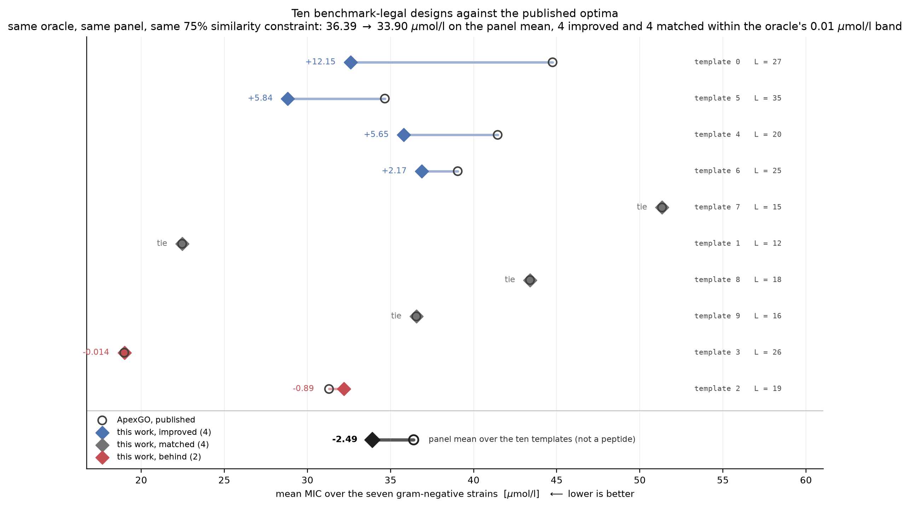
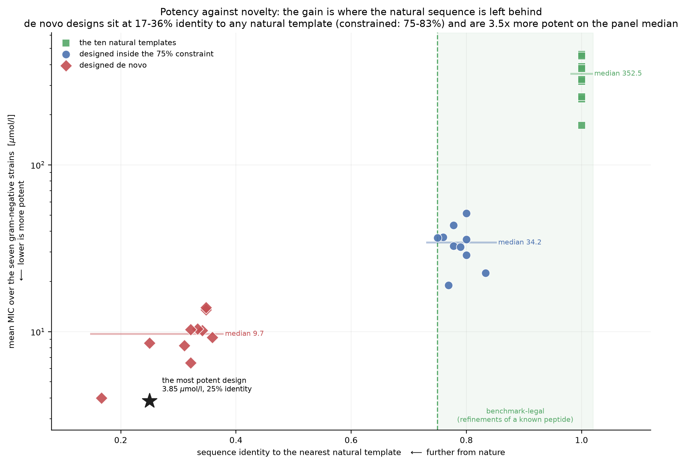
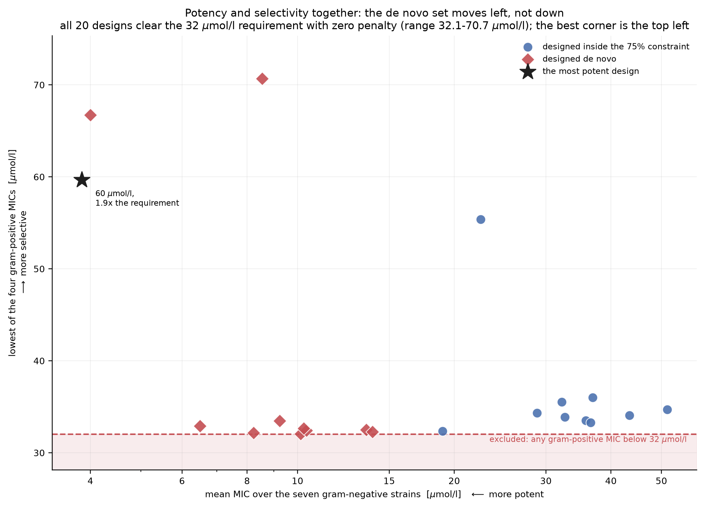

*Demonstrating how an AI Scientist Team can move beyond optimizing known molecules to discovering entirely new drug candidates while satisfying multiple biological objectives.*

**If you read one thing:** Our [AI Scientist Team](/posts/multi-agent-ai-scientist-protein-design) achieves results that match or improve the best performance for eight of the ten peptide templates of a leading antimicrobial peptide model. It generates de novo drug candidates of 3.5× higher predicted potency.

Antimicrobial resistance is one of the most pressing challenges in modern medicine. Particularly concerning are multidrug-resistant Gram-negative pathogens such as *Acinetobacter baumannii*, *Klebsiella pneumoniae* and *Pseudomonas aeruginosa*. Their protective outer membranes make them exceptionally difficult to treat with conventional antibiotics.

Antimicrobial peptides (AMPs) offer a promising alternative. Rather than targeting a single bacterial protein, they can kill bacteria by disrupting their membranes. However, designing effective therapeutic peptides is challenging: increasing antimicrobial potency can also increase toxicity against beneficial bacteria, while the enormous sequence space makes experimental exploration prohibitively expensive.

This is precisely the kind of challenge our AI Scientist Team is designed to address.

We evaluated our system against ApexGO (Torres, Zeng, Wan, Maus, Gardner and de la Fuente-Nunez, *Nature Machine Intelligence*, May 2026), a recently published approach to computational antimicrobial peptide optimization. Our results demonstrate three important capabilities:

- **Benchmark competitiveness:** Our system matches or improves upon published ApexGO results under the same benchmark conditions.
- **De novo molecular discovery:** It identifies entirely new peptide sequences with only 17–36% identity to natural templates and 3.5× greater predicted potency than benchmark-constrained designs.
- **Multi-objective optimization:** It simultaneously optimizes antimicrobial potency and selectivity, satisfying biological constraints throughout the discovery process.

Together, these results demonstrate the potential of our AI Scientist Team to move beyond incremental molecular optimization toward genuinely novel drug discovery.

## Benchmarking against ApexGO

ApexGO is an impressive recent approach to antimicrobial peptide optimization. It combines a transformer variational autoencoder with Bayesian optimization to improve peptide sequences while maintaining at least 75% sequence similarity to their natural templates.

The experimental results are compelling: the authors synthesized 100 optimized compounds, reporting an 85% experimental hit rate and a 72% success rate in improving activity against Gram-negative pathogens. Several compounds also demonstrated promising results in preclinical mouse models of *A. baumannii* infection.

This provides a meaningful benchmark against which to evaluate our system.

We therefore started with the same optimization problem: the same APEX 1.1 prediction oracle, the same eleven-strain panel, the same antimicrobial objective and the same 75% sequence-similarity constraint.

Every MIC in this post is a prediction from that oracle rather than a wet-lab measurement, as is every number we are compared against, because the published baseline is scored by the same instrument. Both sides are therefore measured with the same ruler, which is what makes the comparison a fair one. Experimental validation of the new candidates is the next step, and it is already under way.

*Figure 1. One row per peptide template, under the benchmark's own rules. The open ring is the published ApexGO optimum, the filled diamond our system's design, and the connecting line the difference between them. Lower MIC means greater potency.*

Our system improves on the published optimum for four of the ten templates and reproduces it exactly on four more: those four agree to within 10⁻⁷–10⁻⁵ µmol/l, which is five to seven orders of magnitude inside the oracle's reproducibility of 0.01 µmol/l, the tolerance, measured across devices and batch sizes, within which the same peptide scores the same twice. On the two remaining templates our design finishes marginally behind, by 0.89 and 0.01 µmol/l.

Across the ten templates, the mean MIC against the seven Gram-negative strains decreases from **36.39 to 33.90 µmol/l**, a 6.8% mean improvement. Lower MIC indicates greater antimicrobial potency.

A few percent is the honest size of the gain here, and that is the point of this section rather than a caveat to it: the benchmark is a narrow, heavily worked problem whose published solutions were synthesized and tested in the laboratory, and we match or beat them on eight of ten templates under conditions none of which we chose. That establishes the system as a legitimate optimizer. The large gains appear once the benchmark's own constraint is lifted.

**Our system demonstrates competitive performance against an established approach, providing a foundation for exploring a much larger molecular search space.**

## Beyond optimization: discovering entirely new drug candidates

Most existing computational peptide-design approaches focus on generating or optimizing sequences that resemble known antimicrobial peptides. Discovering entirely new candidates, far removed from natural templates, presents a considerably harder challenge.

This is where our AI Scientist Team demonstrates a particularly interesting capability: it can explore molecular sequence space beyond the neighborhood of known molecules while maintaining the biological requirements of the discovery problem.

To investigate this capability, we evaluated de novo designs without the 75% sequence-similarity restriction, keeping the prediction oracle, bacterial strain panel, antimicrobial objective and selectivity requirement unchanged.

*Figure 2. Each point is one peptide. Further left means further from any natural sequence; lower means more potent. The shaded band on the right is the region the benchmark's 75% similarity constraint confines a design to. The three populations separate cleanly, and the de novo designs occupy the lower-left corner, novel and potent at once.*

The results reveal a striking separation between three populations. Natural templates sit at the top right of the plot, with 100% sequence identity to themselves and a median MIC of 352 µmol/l. Benchmark-constrained designs improve substantially, reaching a median MIC of 34.2 µmol/l, but remain within the predefined similarity boundary. De novo designs occupy a very different region: despite having only **17–36% sequence identity** to their nearest natural templates, they achieve a median MIC of just **9.7 µmol/l**.

This represents a **3.5× improvement in predicted potency** over benchmark-constrained designs.

The gain is uniform rather than selective: every one of the ten template families improves, by between **18× and 46×** over its natural starting sequence. No single exceptional candidate carries the result. Natural antimicrobial peptides are unoptimized starting material, so this figure measures the distance traveled from nature; the measure of final quality is the 3.5× against designs that were themselves optimized.

The most potent candidate is particularly interesting: a **12-amino-acid peptide with a predicted MIC of 3.85 µmol/l, while also satisfying the non-binding constraint against all four Gram-positive strains**. Its worst-case predicted Gram-positive MIC is 59.7 µmol/l, comfortably above the required 32 µmol/l threshold.

This is more than an incremental improvement to a known molecule. It demonstrates the ability of our system to identify entirely new molecular candidates with substantially improved predicted properties while respecting multiple biological requirements.

## Potency without sacrificing selectivity

Antimicrobial potency alone is not sufficient for a viable therapeutic candidate.

A highly cationic and hydrophobic peptide might disrupt bacterial membranes effectively, but it could also damage beneficial bacteria. In therapeutic development, selectivity is therefore just as important as potency.

We explicitly incorporated this requirement into the optimization problem: candidates must maintain a MIC above 32 µmol/l against all four Gram-positive strains while maximizing activity against the seven Gram-negative pathogens.

*Figure 3. Potency on one axis, selectivity on the other. The 32 µmol/l line is the selectivity requirement: every design must lie on the permitted side of it against all four Gram-positive strains. Every design reported here does.*

The figure illustrates the relationship between antimicrobial potency and selectivity. The 32 µmol/l threshold separates candidates satisfying the selectivity requirement from those that do not.

**Every reported design satisfies the selectivity constraint**, including the most potent of them.

The most potent candidate achieves a predicted Gram-negative MIC of 3.85 µmol/l while maintaining a worst-case Gram-positive MIC of 59.7 µmol/l, nearly twice the required threshold.

Releasing the similarity constraint does move the set slightly closer to the selectivity wall: the de novo designs' median worst-case Gram-positive MIC is 32.6 µmol/l, against 34.2 µmol/l for the benchmark-constrained set. Every design in both sets is feasible, none incurs any constraint penalty, because the objective requires selectivity; the next iteration rewards headroom above the threshold rather than merely requiring it.

The important result is that our system does not simply search for peptides with maximum antimicrobial activity. It identifies candidates that balance antimicrobial potency and selectivity simultaneously.

## From generative models to constraint-aware molecular discovery

Most computational peptide-design approaches rely on generative models that learn from known antimicrobial peptides and propose new sequences. However, generating plausible molecules is not the same as discovering molecules that satisfy multiple interacting biological requirements.

A common strategy is to generate candidates first and subsequently filter or re-rank them according to additional objectives and constraints. This can be highly inefficient: in ApexGO's published benchmark comparisons, only 22.2%, 10.8% and 0.2% of HydrAMP proposals satisfied the 75% sequence-similarity constraint at three decoder temperatures. PepDiffusion generated 10,000 sequences, none of which met the constraint.

**Our approach is fundamentally different. We use an AI Scientist Team as an integrated molecular discovery system, rather than relying on a standalone generative model.**

The system incorporates objectives and feasibility constraints directly into the iterative optimization process. Antimicrobial potency across seven Gram-negative strains, selectivity against four Gram-positive strains and the relevant feasibility requirements are evaluated together throughout the search.

This allows the AI Scientist Team to direct its exploration toward candidates that satisfy the actual requirements of the discovery problem, rather than generating large numbers of molecules that must subsequently be discarded.

The underlying architecture and the roles of the individual AI scientists are described in our companion post: [A Multi-Agent AI Scientist Team for Protein Optimization](/posts/multi-agent-ai-scientist-protein-design).

Crucially, the same approach can incorporate additional properties such as solubility, cytotoxicity, stability, manufacturability and resistance risk. These become further optimization objectives or constraints within the discovery process, rather than independent filters applied after candidate generation.

## Toward a new paradigm in molecular discovery

Antimicrobial peptide discovery provides a particularly useful demonstration of our approach because it combines a large molecular search space with competing biological objectives and explicit feasibility requirements.

But the underlying challenge is much broader.

In drug discovery, a promising molecule must rarely optimize just one property. Potency, selectivity, stability, solubility, toxicity and manufacturability all influence whether a candidate can progress toward a viable therapeutic. These requirements interact, and improving one property can easily compromise another.

The three capabilities shown here address exactly that difficulty, and they build on one another: the AI Scientist Team is competitive with an established approach under identical benchmark conditions, it remains competitive once the similarity constraint that defined the benchmark is removed and the search moves far away from known templates, and it does both while holding a selectivity requirement throughout rather than imposing it afterwards. Benchmark competitiveness alone would show only that the system is a credible optimizer; de novo discovery alone would be unconvincing without the constraint; it is the combination that matters for a therapeutic program.

Rather than simply generating molecules or optimizing individual properties, we are building AI systems that actively explore molecular space, reason about competing objectives and systematically search for candidates that satisfy the requirements of real-world applications.

The antimicrobial peptide results provide an initial demonstration of this capability. The next step is to take the most promising candidates into experimental validation and establish how well the computational improvements translate into biological activity.

---

### Key results

| Capability | Result |
|---|---|
| Benchmark performance | Improves on 4 of 10 ApexGO optima; reproduces 4 exactly |
| Benchmark potency | Mean MIC: 36.39 → 33.90 µmol/l (6.8%) |
| De novo discovery | 17–36% identity to nearest natural templates |
| Potency improvement | 3.5× over benchmark-constrained designs |
| Consistency | All 10 template families improve |
| Best predicted candidate | 3.85 µmol/l |
| Selectivity | All candidates satisfy the 32 µmol/l threshold |
| Best candidate's Gram-positive MIC | 59.7 µmol/l |

**The broader implication:** We are moving from AI that modifies existing molecules toward AI Scientist Teams that discover entirely new candidates while optimizing multiple biological objectives simultaneously.

That is the foundation of a scalable AI-driven molecular discovery platform.

---

### Work with us on the next campaign

We run these campaigns against our partners' targets: a defined objective, an explicit set of constraints, and a ranked shortlist of candidates to take into the laboratory. If you are developing peptide or protein therapeutics and want the next shortlist to come from a system that optimizes every requirement at once, we would like to hear from you.

---

*Technical note: All MIC values reported in this analysis are predictions from the APEX 1.1 ensemble oracle, the same benchmark prediction instrument used to evaluate the published baselines. They are computational estimates, not experimentally measured MIC values. The figures are generated directly from the stored oracle records. Experimental validation of the newly identified candidates remains an important next step.*
