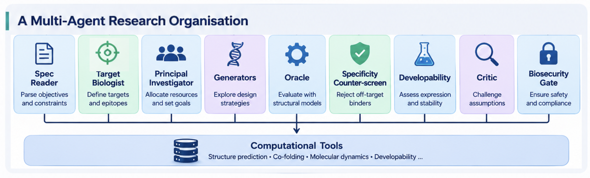
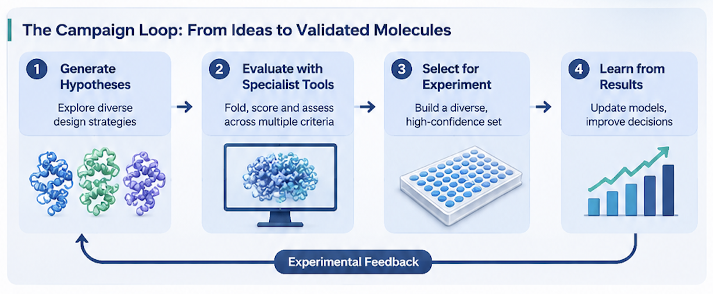
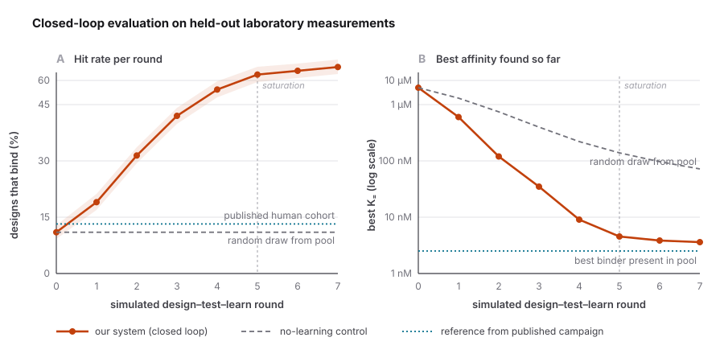

Computational protein design has a measurement problem: models produce confident predictions, but those predictions are only imperfectly related to whether a molecule actually works in the lab. Public protein-design competitions make this gap visible. Published standardized wet-lab results show hit rates across campaigns ranging from 2.5% to 14%. The central challenge is therefore not simply to generate promising molecules, but to decide which ones deserve an experimental slot, and to learn from the results.

## A Multi-Agent Research Organization

We are building an AI Scientist Team as a research organization with specialized responsibilities, rather than a single general-purpose agent. A single agent tasked with running an entire campaign must generate ideas, evaluate its own proposals, allocate resources and judge its own confidence. Separating these responsibilities creates independent perspectives and makes it easier to challenge weak assumptions.

The organization consists of several specialized roles:

| Role | Responsibility |
|---|---|
| **Spec Reader** | Converts the campaign brief into explicit objectives, positive and negative targets, constraints and evaluation criteria. |
| **Target Biologist** | Prepares target structures, identifies relevant epitopes and defines the molecular interactions to promote or avoid. |
| **Principal Investigator** | Coordinates the campaign, allocates computational and experimental resources, and sets decision and stopping criteria. |
| **Generators** | Explore parallel design strategies, including diffusion-based design, sequence optimization, nanobody and antibody design, and grafting. |
| **Oracle** | Evaluates candidates using co-folding, structural analysis and energetic calculations. |
| **Specificity Counter-screen** | Tests whether candidates interact with unintended targets or molecular configurations. |
| **Developability Specialist** | Assesses expression risks, aggregation, free cysteines, format constraints and other developability criteria. |
| **Critic** | Challenges assumptions, identifies metric gaming, checks for data leakage and scrutinises confidence estimates. |
| **Biosecurity Gate** | Performs sequence screening and dual-use review before designs leave the system. |

Each role produces structured outputs that the next stage can inspect and use. The workflow is therefore not just a sequence of conversations: it is an auditable process in which decisions, evidence and computational results are explicitly connected.

### Specialized Intelligence for Different Chemical Contexts

General-purpose foundation models are trained to perform across broad distributions of tasks. This makes them powerful starting points, but their reliability can vary substantially across molecular configurations, chemical environments and interaction types.

Our approach adds specialized, task-specific focus modules. Rather than treating every model prediction as equally reliable, these modules learn when to trust, discount or combine the outputs of underlying models for a particular chemical context.

The modules integrate several complementary sources of evidence:

- **Pretrained molecular embeddings**, capturing information from protein and molecular language models.
- **Structural features**, extracted from structure prediction and protein–protein co-folding.
- **Dynamic features**, derived from molecular-dynamics simulations, including conformational flexibility, stability and interaction persistence.

These information channels and evaluation components can be activated or deactivated individually during optimization. The system can therefore learn not only how to interpret a given source of evidence, but also when that source is useful for a particular subtask. We fine-tune focus modules for individual chemical tasks rather than relying exclusively on one global model to handle every situation.

The distinction is important: the research agents coordinate the scientific workflow; the focus modules provide specialized, learned interpretation of molecular evidence.

## Validation: Replaying Real Laboratory Campaigns

Evaluating an autonomous design system is hard because the ground truth lives in a wet lab, and a model that merely agrees with another model proves nothing. We therefore evaluate ours against measurements that already exist.

Public design competitions have released many thousand protein and peptide designs together with the binding affinities measured for them, successes and failures alike, across more than twenty targets. We hold these measurements out and replay each campaign as a closed loop. In each round the system proposes a batch of candidates; we reveal only the real laboratory result for that batch, exactly as a lab would return it; the system updates and proposes again. It never sees a measurement it has not “paid” for with an experiment.

The question this answers is not *can the system recognize a good binder*, but *how few experiments does it need to find one*. What we observe (see figure below), performance climbs steeply over the first rounds as the system learns what distinguishes the binders of this particular target from the near-misses, then saturates once the informative molecules in the pool have been exhausted, the point at which further experiments stop buying information. We report the round at which that happens, the hit rate at saturation against a no-learning control drawn from the same pool, and the best affinity recovered against the best affinity the pool contains.

Across held-out targets, the system reaches the quality of the published human campaigns in roughly a quarter of the experiments those campaigns required. We weight most heavily the datasets released after our models were trained, and we report those separately.

*Retrospective evaluation establishes efficiency: the system is choosing from molecules that already exist.*

## Learning Across Campaigns

A system that starts from scratch with every new target loses much of the knowledge accumulated in previous experiments. We want the opposite: a research organization that becomes more capable with every campaign.

Three forms of knowledge persist:

**Calibration from experimental outcomes.** Public campaign data allow us to estimate how reliably different models and design methods perform in different contexts. Instead of asking only what a model predicts, we ask how often predictions of that kind have corresponded to successful experimental outcomes. These calibration models can then inform subsequent design and selection decisions.

**Failure memory.** Every candidate is stored with its provenance: the generator, binding mode, target context, evaluation results and reasons for rejection. When a new target resembles an earlier one, relevant successes and failures can inform the next campaign. This prevents the system from repeatedly exploring attractive approaches that have already failed.

**Evolving scientific heuristics.** Design rules, evaluation criteria and resource-allocation strategies are versioned and revised as new evidence emerges. They become persistent, inspectable components of the system rather than instructions that researchers must manually reconstruct for each project.

The objective is a compounding research capability: later campaigns should benefit measurably from the evidence and experience accumulated in earlier ones.

## A System That Can Run Campaigns

The agent organization depends on a reliable computational foundation. Beneath the reasoning layer is a collection of structured tools for structure prediction and co-folding, diffusion-based design, sequence optimization, antibody and nanobody design, energetic evaluation, molecular dynamics and developability analysis.

Each tool has defined inputs and outputs. Agents can request computations and interpret their results, but quantitative measurements come from the tools themselves. This separation makes decisions reproducible.

The infrastructure also needs to support campaigns at scale. Candidates pass through progressively more expensive evaluation stages: inexpensive filters screen large sets, while more demanding structural and physical calculations are reserved for promising candidates. Parallel execution allows independent design strategies to run simultaneously, and a provenance record preserves the complete history of every candidate.

**Discovery as a portfolio optimization problem**

A protein-design campaign has a finite experimental budget. The objective is not simply to select the twenty highest-scoring sequences. It is to maximise the probability of experimental success under uncertainty.

Candidates generated by the same method, scaffold or binding hypothesis can be highly correlated. Selecting only the top-ranked designs may therefore create a portfolio of near-duplicates: if the underlying assumption is wrong, they can all fail together.

A better strategy distributes experimental resources across genuinely different hypotheses, weighs candidates according to calibrated confidence, and considers the information that each experiment could provide. A failed experiment should still improve the next decision.

This is why we build an organization that can generate, challenge, evaluate and learn, not merely a model that ranks sequences. Ultimately, the value of an AI Scientist Team will be measured not by the sophistication of its architecture, but by the quality of the molecules it helps discover and the experimental resources it saves along the way.

**Safety is at the heart of what we do**

Safety is integrated into this workflow. Sequence screening and dual-use review operate as explicit gates, with recorded outcomes, rather than relying on an agent's judgement or a final manual check. The same provenance infrastructure that supports scientific learning makes designs traceable and decisions auditable.

